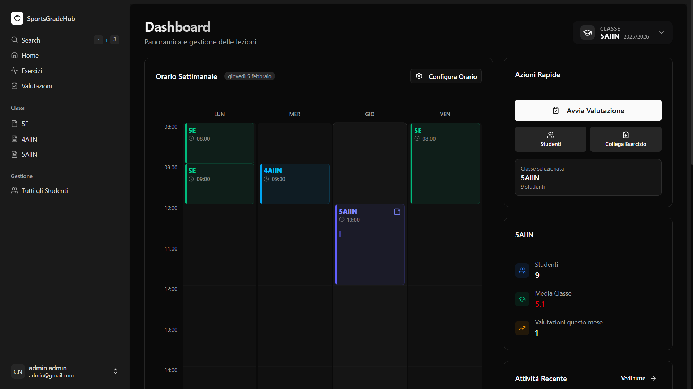

<div align="center">
  

  <h1>SportsGradeHub</h1>

  <p><strong>Classi, attività e valutazioni di educazione fisica, in un unico spazio.</strong></p>
  <p>Organizza le lezioni, registra le prestazioni e segui i progressi degli studenti.</p>

  <p>
    <a href="https://sports-grade-hub.vercel.app">Apri l’app</a> ·
    <a href="#avvio-locale">Avvio locale</a> ·
    <a href="https://github.com/Motoria-React-App/Backend--SportGradeHub">Backend</a> ·
    <a href="https://github.com/Motoria-React-App/SportsGradeHub/issues">Segnala un problema</a>
  </p>

  <p>
    
    
    
    
  </p>
</div>



## Il progetto

SportsGradeHub è un’applicazione web per la gestione dell’educazione fisica a scuola. Riunisce l’organizzazione delle classi, il catalogo degli esercizi e la registrazione delle valutazioni, con riepiloghi per classe e per studente.

Questo repository contiene il **frontend**. L’autenticazione e l’accesso ai dati dipendono dal [backend dedicato](https://github.com/Motoria-React-App/Backend--SportGradeHub), basato su Express e Firebase Admin.

## Funzionalità

| Area | Cosa puoi fare |
| --- | --- |
| **Dashboard** | Consultare l’orario settimanale, le attività recenti e il riepilogo della classe selezionata. |
| **Classi e studenti** | Gestire gli iscritti, consultare le schede individuali, trasferire gli studenti e archiviare le classi degli anni precedenti. |
| **Esercizi** | Creare attività, organizzarle in gruppi e associarle alle classi. |
| **Valutazioni** | Registrare prestazioni e voti con intervalli, criteri o intervalli per criterio; configurare periodi e sistemi di valutazione. |
| **Analisi e classifiche** | Esplorare i risultati con grafici e confrontare le prestazioni nelle classifiche. |
| **Esportazione e backup** | Esportare dati in CSV o Excel e utilizzare gli strumenti di importazione ed esportazione nelle impostazioni. |

L’interfaccia si adatta a desktop e mobile, offre tema chiaro e scuro e include traduzioni in italiano e inglese. Il progetto configura anche una PWA con manifest e service worker; le operazioni sui dati richiedono il backend.

## Da dove iniziare

1. Accedi all’app oppure crea un account.
2. Crea una classe e aggiungi gli studenti.
3. Prepara gli esercizi e collegali alla classe.
4. Configura nelle impostazioni l’orario, i periodi e il sistema di valutazione.
5. Registra le prestazioni e consulta i riepiloghi dalla dashboard e dalle schede degli studenti.

La ricerca rapida si apre dalla barra laterale oppure con **Alt + J** o **⌘ + J**.

## Avvio locale

### Requisiti

- **Node.js 20 o superiore**, compatibile con le dipendenze del progetto.
- **npm** e Git.
- Un backend SportsGradeHub raggiungibile e la relativa chiave API.

### 1. Installa il progetto

```bash
git clone https://github.com/Motoria-React-App/SportsGradeHub.git
cd SportsGradeHub
npm ci
```

### 2. Configura la connessione

Copia [`.env.example`](.env.example) in un nuovo file `.env`, nella stessa cartella di `package.json`.

| Variabile | Valore da inserire |
| --- | --- |
| `VITE_API_URL` | URL di base del backend, senza `/api` finale. L’esempio contiene l’indirizzo del backend online. |
| `VITE_API_KEY` | Lo stesso valore configurato come `SGH_API_KEY` sul backend. |
| `VITE_MAINTENANCE_MODE` | Opzionale: `true` mostra la pagina di manutenzione. |

Per usare un backend locale, imposta `VITE_API_URL=http://localhost:3000` e avvia separatamente il progetto backend con la sua configurazione. Avviare solo il frontend non avvia anche il server API.

Il file `.env` è escluso da Git. Le variabili `VITE_*`, però, vengono incluse nel codice destinato al browser: non usarle per credenziali Firebase Admin, chiavi private o segreti riservati al server.

### 3. Avvia il frontend

```bash
npm run dev
```

Apri l’indirizzo indicato da Vite nel terminale, normalmente `http://localhost:5173`. Riavvia il server di sviluppo dopo aver modificato `.env`.

## Comandi

| Comando | Risultato |
| --- | --- |
| `npm run dev` | Avvia il server di sviluppo con aggiornamento automatico. |
| `npx tsc -b` | Controlla i tipi TypeScript senza generare la build dell’app. |
| `npm run build` | Controlla TypeScript e genera la build di produzione in `dist/`, incluso il service worker. |
| `npm run preview` | Serve localmente la build già generata. |
| `npm run lint` | Esegue ESLint; richiede una configurazione ESLint, attualmente assente dal repository. |

## Pubblicazione

Il frontend è pubblicato su [Vercel](https://sports-grade-hub.vercel.app). Per configurare un deployment:

1. Installa le dipendenze con `npm ci`.
2. Imposta `VITE_API_URL` e `VITE_API_KEY` nell’ambiente di build della piattaforma.
3. Usa `npm run build` come comando di build e `dist` come cartella di output.
4. Verifica che il backend accetti l’origine del frontend nella configurazione CORS.

Il file [`vercel.json`](vercel.json) riscrive le richieste verso `index.html` per supportare le rotte di React Router, anche quando si apre direttamente una pagina interna.

Le variabili Vite vengono lette durante la build: dopo averle cambiate in produzione occorre generare un nuovo deployment.

## Risoluzione dei problemi

| Problema | Cosa verificare |
| --- | --- |
| **“API Key is not valid”** | `VITE_API_KEY` deve essere valorizzata nel `.env` del frontend. Riavvia Vite dopo la modifica. |
| **“Api Key is required” dal backend** | La chiave inviata deve coincidere con `SGH_API_KEY` del server. |
| **Connessione rifiutata a localhost:3000** | Il backend locale deve essere avviato. Se usi quello online, aggiorna `VITE_API_URL`. |
| **Errore CORS** | L’origine del frontend, inclusi protocollo e porta, deve essere consentita dal backend. |
| **Configurazione vecchia dopo il deployment** | Ricostruisci l’app con le variabili aggiornate e verifica l’aggiornamento del service worker. |

## Struttura del codice

```text
src/
├── components/     Componenti condivisi, sidebar e interfaccia
│   └── ui/         Componenti di base
├── pages/          Dashboard, classi, studenti, esercizi e valutazioni
├── provider/       Client API e contesti per impostazioni, orario e ricerca
├── hooks/          Traduzioni, formattazione ed esportazione
├── lib/            Traduzioni, animazioni e utilità condivise
├── types/          Tipi di dominio
├── utils/          Utilità per record e classifiche
├── App.tsx         Rotte e layout delle pagine autenticate
└── main.tsx        Ingresso dell’applicazione
public/             Logo, icone PWA e immagini dell’onboarding
```

| Ambito | Tecnologie |
| --- | --- |
| Applicazione | React 18, TypeScript, Vite, React Router |
| Interfaccia | Tailwind CSS, componenti shadcn/ui e Radix UI, Lucide, Framer Motion |
| Dati e visualizzazione | React Context, TanStack Table, Recharts, XLSX |
| PWA | vite-plugin-pwa e Workbox |

## Contributi e segnalazioni

Per un bug, apri una [issue](https://github.com/Motoria-React-App/SportsGradeHub/issues) indicando i passaggi per riprodurlo, il comportamento atteso e il browser utilizzato. Rimuovi credenziali e dati personali da screenshot e log.

Per proporre una modifica, crea un branch dedicato e apri una pull request con una descrizione del cambiamento e delle verifiche effettuate. Prima dell’invio esegui almeno `npm run build`.

## Sostieni il progetto

Se SportsGradeHub ti è utile, puoi [offrire un caffè ad aamritt](https://buymeacoffee.com/aamritt).

Il pulsante ufficiale è presente anche nella barra laterale dell’app. L’integrazione si trova in [`coffee-banner.tsx`](src/components/coffee-banner.tsx); lo script è contenuto in un iframe perché utilizza `document.writeln`.

---

Un progetto di [Motoria React App](https://github.com/Motoria-React-App).
